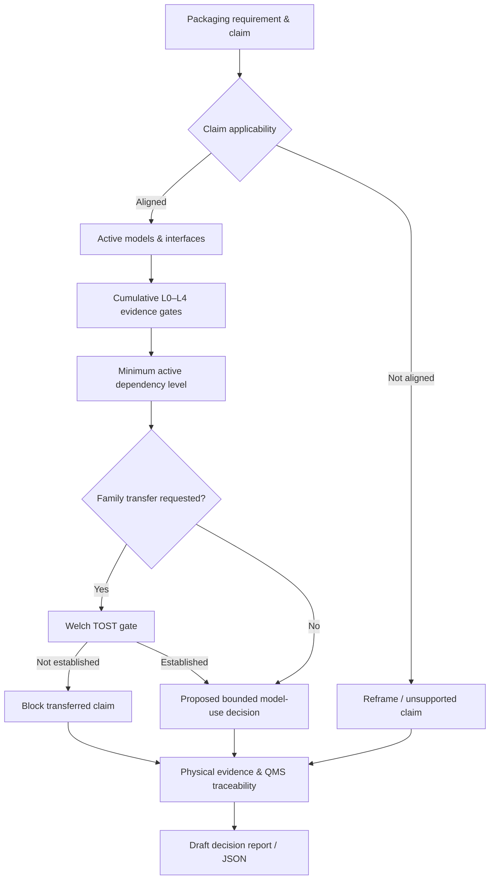

# SVG Explorer v0.1 — Implemented architecture

**Architecture:** Static, local-first ES module web app. No remote API calls, dependencies, analytics, telemetry, passwords, external CDN or data storage server. Separate pure JS statistical and governance modules are used by the UI.

### Modules

- `src/engine.js`: evaluates the scenario, records scope errors and authority caps, returns stable structured output. Contains no browser APIs.
- `src/statistics.js`: Welch mean-equivalence tests, Student-t CDF/quantile and special functions. Contains no browser APIs.
- `src/catalog.js`: author-proposed levels, evidence/task state enums and packaging phase example prompts.
- `src/examples.js`: public benchmark aggregate interpretation and clearly synthetic fixtures.
- `src/io.js`: whitelists known schema properties on JSON import; exports decision and editable scenario.
- `src/app.js`: DOM presentation, five screens, event delegation, optional browser-only save and JSON download.
- `assets/styles.css`: responsive layout and print report.
- `sw.js`: versioned cache of same-origin, public static app assets for offline use after successful initial load.
- `scripts`: zero-dependency build and local server.
- `tests`: `node:test` checks of expected outcomes and invariants.

### Deploy

The GitHub Pages workflow tests before publishing, builds an isolated `dist/` and uploads it with `actions/upload-pages-artifact@v4`, then deploys with `actions/deploy-pages@v4`. Relative asset paths support project pages at `/repo/` and root pages.

### Data and trust boundaries

All example data are PUBLIC_AGGREGATE or SYNTHETIC as indicated. Inputs are user assertions, not verified citations or model outputs. Unknown, failed and non-applicable gate states never become PASS. External integration and cloud storage do not exist. The user explicitly selects local Save or downloads a report. The software never issues a compliance approval.

### Future architectural changes

A future front end may use React/TypeScript, but the pure policy engine should remain separately versioned. Future formal integrations should preserve source provenance, decision COU, reviewers, independent verification, audit trail, and re-evaluation triggers under a controlled QMS. See `ARCHITECTURE_INITIAL_PROPOSAL.md` for the original technology proposal.
